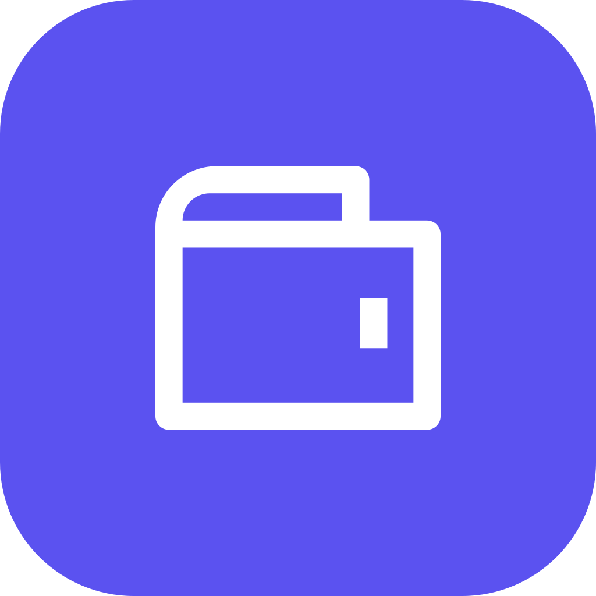
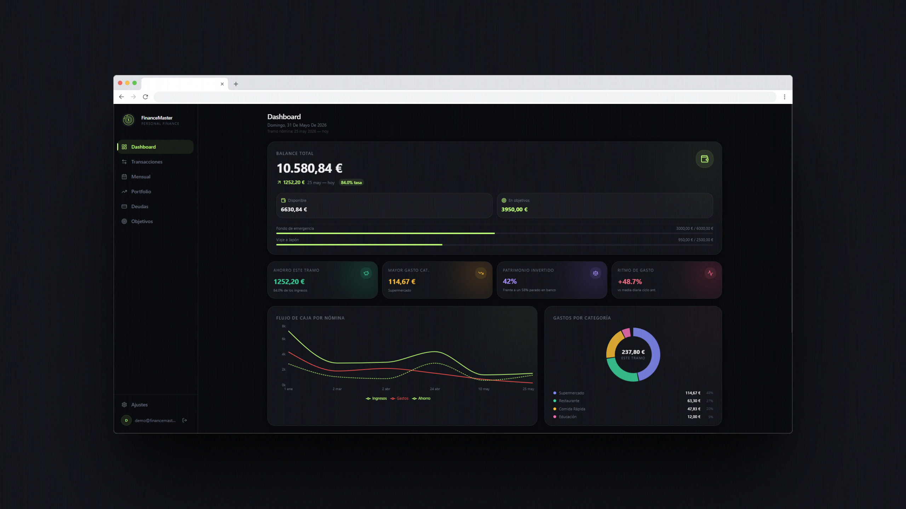

<div align="center">



# FinanceMaster

**Tu gestor de finanzas personales, autoalojado y sin suscripciones.**

Conecta Trade Republic y MyInvestor, importa los extractos de BBVA, N26, Revolut, Wise y cualquier otro banco por CSV, analiza tus gastos, sigue tus inversiones y mantén el control total de tu dinero — todo en una sola app que puedes instalar en el móvil.

[](https://ghcr.io/ronambulo/financemaster)
[](LICENSE)
[](https://ghcr.io/ronambulo/financemaster)

</div>

---

## 📸 Vista previa



> Las capturas corresponden a la versión anterior de la interfaz.

---

## ✨ Características

| Sección | Descripción |
|---|---|
| 🏠 **Inicio** | Lo que te queda del mes, ritmo de gasto, próximos cargos, avisos, perfil de gasto y patrimonio. Tarjetas que puedes ordenar y ocultar. |
| 💳 **Movimientos** | Listado con filtros, búsqueda, agrupación por día, categoría, comercio o cuenta. Selección múltiple para categorizar, fusionar, mover o excluir. Categorización con IA. |
| 🏦 **Cuentas** | Saldos de bancos y brokers, cartera de inversión con gráfica de precio por posición, posiciones manuales y actualización de precios en vivo. |
| 📅 **Mes a mes** | Resumen por ciclos de nómina o meses naturales, con lo invertido en cada periodo y exportación a PDF o Excel. |
| 🧾 **Presupuestos** | Límites de gasto por categoría con aviso al acercarte al tope. |
| 🔁 **Recurrentes** | Detección automática de suscripciones y recibos, previsión del próximo cargo y marcado manual desde un movimiento. |
| 🎯 **Objetivos** | Metas de ahorro, dinero disponible después de apartar lo de los objetivos y reparto del sueldo entre gastos, ahorro e inversión. |
| 💸 **Deudas** | Préstamos, cuotas y amortizaciones con historial de pagos. |
| 🏆 **Logros** | Rachas y retos financieros. |
| 🤖 **Asistente IA** | Chat sobre tus finanzas y categorización automática de movimientos. |
| ⚙️ **Ajustes** | Tema claro/oscuro, modo ultra simple, funciones activables, categorías y reglas, webhooks, tokens de API, exportación y copias completas de la cuenta. |
| 🛡️ **Administración** | Usuarios, permisos de IA por usuario (modelo y consumo), copias de seguridad del servidor, avisos y actividad. |

---

## 🏦 Bancos y brokers

| Entidad | Conexión directa | Importación CSV |
|---|:---:|:---:|
| Trade Republic | ✔ | ✔ |
| MyInvestor | ✔ | ✔ |
| BBVA | | ✔ |
| N26 | | ✔ |
| Revolut | | ✔ |
| Wise | | ✔ |
| Otro banco | | ✔ (detección automática de columnas) |

Además puedes crear cuentas manuales (efectivo, otras cuentas) y posiciones de inversión manuales.

### Conexión directa (Trade Republic y MyInvestor)

1. En **Cuentas → Añadir cuenta**, elige Trade Republic o MyInvestor.
2. Introduce tus credenciales y confirma el acceso (código o aviso en la app del banco).
3. Los movimientos, el efectivo y la cartera se sincronizan solos.

Las credenciales se guardan cifradas y la app se reconecta automáticamente al abrirla. En **Ajustes → Diagnóstico** tienes herramientas para comprobar el saldo con Trade Republic y reparar datos (duplicados, movimientos que faltan, participaciones, tickers…).

---

## 📥 Importar por CSV

1. Descarga el extracto de movimientos desde la web o la app de tu banco.
2. En FinanceMaster abre **Cuentas → Añadir cuenta → Otro banco por CSV** (o **Importar** desde el menú).
3. Arrastra el archivo. El formato del banco se detecta automáticamente.
4. Revisa la vista previa: los duplicados se descartan y los movimientos se categorizan con tus reglas.

---

## 📈 Inversiones

* Acciones, ETFs y fondos de Trade Republic, MyInvestor o posiciones manuales.
* Precio en vivo y gráfica por posición (1 mes, 6 meses, 1 año, 5 años).
* Beneficio/pérdida total y por posición, agrupado por broker.
* Dividendos e intereses recibidos.

---

## 🎨 Personalización

* Tema claro, oscuro o el del sistema.
* **Modo ultra simple**: solo lo esencial, con las funciones que elijas.
* Funciones activables desde **Ajustes → Funciones**: cuentas, inversión, presupuestos, mes a mes, recurrentes, objetivos, deudas, logros y asistente IA.
* Tarjetas de Inicio reordenables.
* Categorías personalizadas con icono y reglas automáticas (con vista previa de a cuántos movimientos afectan).
* Moneda principal y primer día del mes (nómina o día fijo).

---

## 📱 App instalable (PWA)

FinanceMaster se puede instalar en la pantalla de inicio del iPhone o Android y funciona como una app nativa: barra inferior, gestos, bloqueo automático y recarga sola al actualizar el servidor.

---

## 🧙 Asistente de configuración (Onboarding)

Al crear tu cuenta, un asistente guiado te permite:

1. Elegir modo normal o ultra simple.
2. Activar o desactivar funciones.
3. Conectar o importar tus primeras cuentas.

Puedes volver a configurar todo esto en **Ajustes** en cualquier momento.

---

## 🚀 Instalación

### Docker (recomendado)

```yaml
services:
  financemaster:
    image: ghcr.io/ronambulo/financemaster:latest
    container_name: financemaster
    restart: unless-stopped
    ports:
      - "8000:8000"
    volumes:
      - /ruta/a/tus/datos:/data
    environment:
      - SECRET_KEY=cambia-esto-por-una-clave-secreta-larga-y-aleatoria
      - DATABASE_URL=sqlite:////data/finance.db
      # Opcional — para el asistente IA (Groq o Google Gemini)
      - AI_API_KEY=tu-api-key
      - AI_PROVIDER=groq   # groq | gemini
```

```bash
docker compose up -d
```

Abre **http://localhost:8000** en tu navegador, crea tu cuenta y sigue el asistente de configuración.

---

### Desarrollo local

**Requisitos**

* Python 3.11+
* Node.js 18+

```bash
git clone https://github.com/Ronambulo/FinanceMaster.git
cd FinanceMaster
```

#### Backend

```bash
cd backend
pip install -r requirements.txt
uvicorn main:app --reload --port 8000
```

#### Frontend

```bash
cd frontend
npm install
npm run dev
```

| Servicio | URL |
|---|---|
| API + Frontend (producción) | http://localhost:8000 |
| Frontend (desarrollo) | http://localhost:5173 |

---

## 🛠️ Stack tecnológico

### Backend

* FastAPI
* SQLAlchemy + SQLite
* yfinance (datos de mercado)
* Trade Republic y MyInvestor (sincronización directa)
* JWT Authentication
* Groq / Google Gemini (asistente IA, formato OpenAI compatible)

### Frontend

* React 18 + TypeScript
* Vite
* Componentes propios con CSS-in-JS y SVG
* jsPDF / SheetJS (exportación PDF y Excel)
* TanStack Query (caché y sincronización)
* Zustand (estado global)
* PWA instalable (service worker)

### Despliegue

* Docker multi-arquitectura (amd64 / arm64)
* Compatible con CasaOS y ZimaOS
* CI/CD con GitHub Actions

---

## 🔒 Privacidad

Tus datos son tuyos.

* Sin suscripciones.
* Sin servicios externos obligatorios.
* Sin compartir información financiera con terceros.
* Base de datos SQLite local.
* Despliegue completamente autoalojado.

---

## 🤝 Contribuir

Las contribuciones son bienvenidas.

1. Abre un Issue para reportar errores o sugerir mejoras.
2. Haz un Fork del proyecto.
3. Crea una rama para tu funcionalidad.
4. Envía un Pull Request.

---

## 📄 Licencia

Este proyecto se distribuye bajo la licencia MIT.
